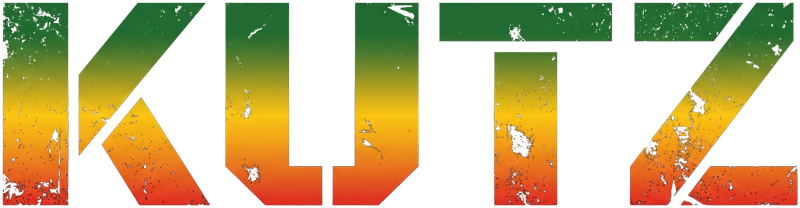
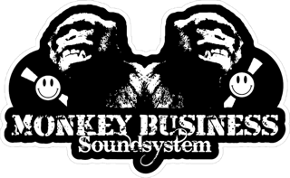
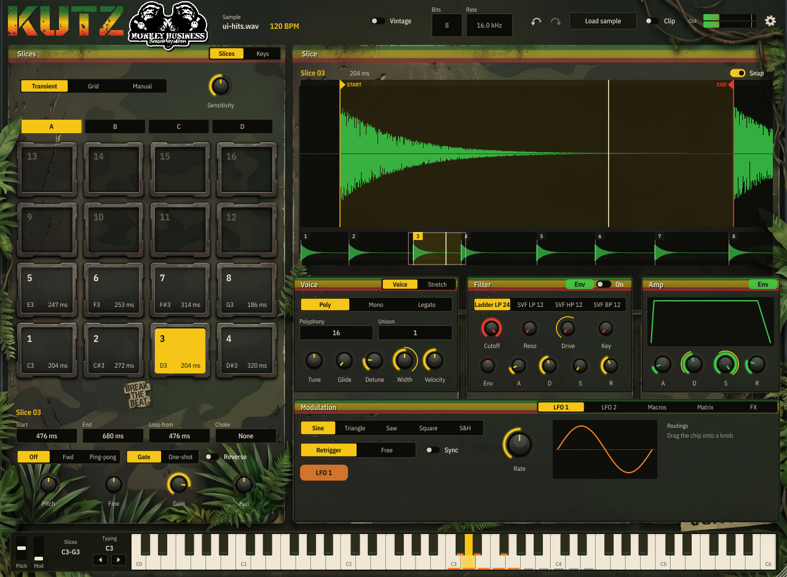

  
  &nbsp;&nbsp;
  

# KUTZ releases

KUTZ is a free slicer with a sampler mode (VST3, CLAP, LV2, Audio Unit and standalone) by
**Monkey Business Soundsystem**: load a break, cut it at its transients, on a tempo grid or by hand, and
play the slices from pads, keys or MIDI, with a filter, cyclic stretch, a vintage low-bit mode,
drag-and-drop modulation and an effects rack made for jungle, drum & bass, dub and breakbeat.

## Download

Get the latest version from the **[Releases page](https://github.com/Antik79/kutz-releases/releases)**:

| System | File |
|---|---|
| Linux (64-bit) | `KUTZ-<version>-linux-x86_64.tar.gz` |
| Windows (64-bit) | `KUTZ-<version>-windows-x64.zip` |
| macOS (Apple Silicon, macOS 11+) | `KUTZ-<version>-macos-arm64.zip` |

On macOS, install with the included `install.sh` (in Terminal: `bash install.sh`). KUTZ isn't signed by
Apple yet, and the installer lifts macOS's block on downloaded plugins for KUTZ's own files. There is no
build for Intel Macs.

Installation, the full manual and troubleshooting are in the
**[KUTZ documentation](https://antik79.github.io/kutz-docs/)**.

KUTZ is free to use but not open source. Once installed, it checks this repository once a day and tells
you when a new version is out.

## Support Monkey Business Soundsystem

KUTZ is made with and for **Monkey Business Soundsystem**, the Belgian jungle, drum & bass and breakbeat
crew. Check out their events, music and artists at **[mbss.be](https://www.mbss.be)**. If KUTZ is useful
to you, a donation to support Monkey Business Soundsystem is very welcome.
